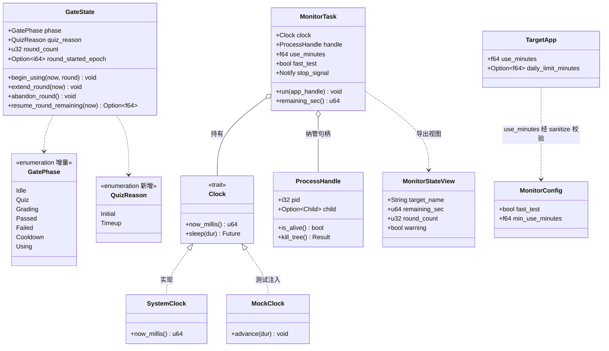
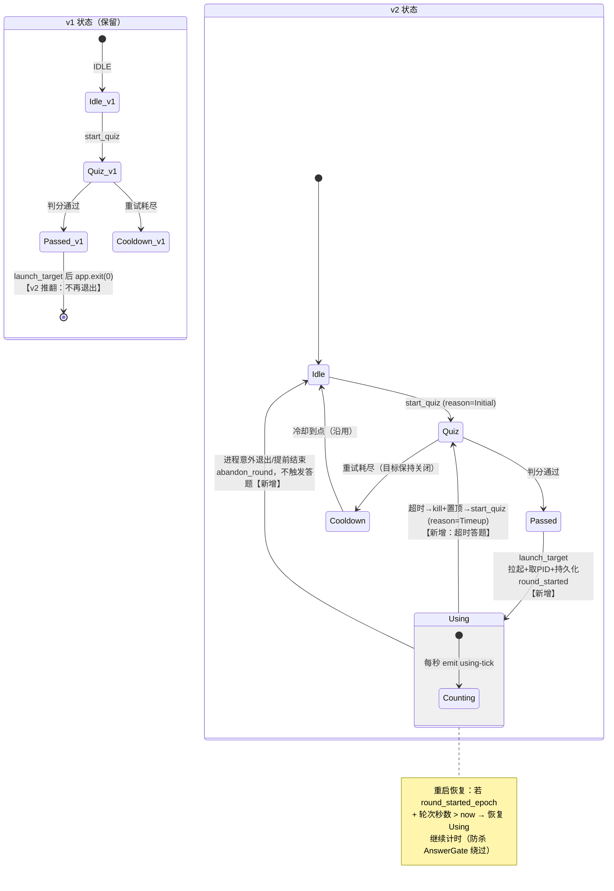
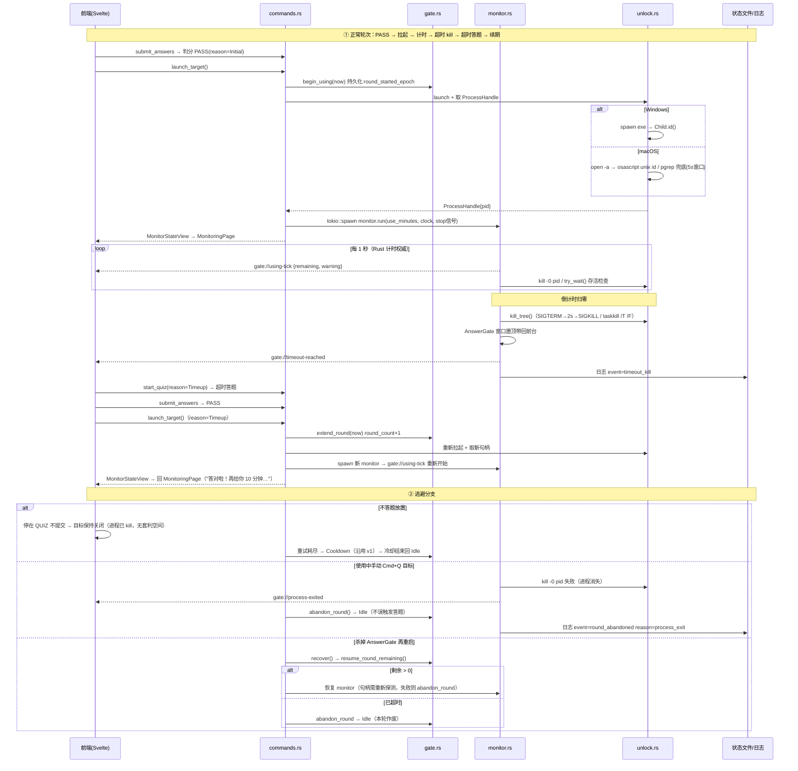

# AnswerGate v2 增量架构设计 — 使用时长持续管控（纳管 + 轮次制）

- **架构师**: 高见远（Bob / Gao）
- **输入**: `docs/PRD-v2-incremental.md`（P0-12~P0-19、Q1~Q5 默认决策）、`docs/ARCHITECTURE.md`（v1）、v1 已实现代码
- **版本**: v2.0-incremental（仅描述 v1 之上的变更，未提及部分沿用 v1 架构与共享知识）
- **基线事实（已核对源码）**: v1 共 8 个 command、`GatePhase{Idle,Quiz,Grading,Passed,Failed,Cooldown}`、状态文件 `.answergate_gate_state.json`、macOS `open -a` 启动后 `app.exit(0)`、cooldown ticker 为 std::thread 每秒 emit

---

## Part A · 增量系统设计

### 1. 实现方案与选型（增量部分）

#### 1.1 核心技术挑战与对策

| # | 挑战 | 对策 |
|---|------|------|
| C8 | **macOS `open -a` 拿不到 PID**（进程由 launchd 托管，非 open 子进程） | 三级取句柄策略（见 1.2）；`open` 退避到 osascript/pgrep 兜底 |
| C9 | Windows 多进程目标（如浏览器主+子进程）kill 不干净 | `taskkill /PID <pid> /T /F`（进程树终止，系统自带） |
| C10 | 计时可被重启 AnswerGate 绕过 | 本轮开始时间 `round_started_epoch` 持久化到状态文件；重启恢复时**按剩余时长继续计时**而非重置 |
| C11 | 计时器测试要真等 10 分钟 | 可注入时钟 `Clock` trait（`SystemClock` / `MockClock`）+ `use_minutes` 小数 + `[monitor] fast_test` |
| C12 | AnswerGate 常驻后的误退出 | 单实例锁（tauri-plugin-single-instance）+ CloseRequested 事件拦截 → 前端二次确认 → `confirm_exit` command |
| C13 | 进程意外退出误触发答题 | monitor 轮询检测句柄失效 → 事件 `gate://process-exited` → 状态机回 Idle，不进 QUIZ |

#### 1.2 进程句柄与 kill 选型结论（最大风险项）

**决策：不引入 sysinfo，采用"系统自带命令 + 直接句柄"的纯 Command 方案。**

理由：纳管的是**单目标、由本程序拉起**的进程，无需全量进程表扫描；sysinfo 每次快照遍历所有进程（macOS 上开销显著）且 Android target 无意义；osascript/pgrep/taskkill/kill 均为系统自带，零新依赖、行为可测。

| 平台 | 取 PID 句柄 | 存活检查 | 超时 kill |
|------|------------|---------|-----------|
| **Windows** | `Command::spawn(exe)` 直接返回 `Child::id()`（**天然可靠，首选主路径**） | `Child::try_wait()`（零开销） | `taskkill /PID <pid> /T /F` |
| **macOS** | ① 主选：osascript `unix id of application "<bundle_id_or_name>"`（App 完全启动后才有值）→ ② 兜底：`pgrep -f <app_path>`（匹配完整路径，避免同名误杀）→ ③ 均失败则报 `MonitorFailed` 并回 Idle（**宁可不管控，不误杀**） | `kill -0 <pid>` | `kill <pid>`（SIGTERM）→ 2s 后仍存活 `kill -9` |
| **Android** | 不取句柄（Q3 降级） | 不检查 | **不强杀**：到点仅抢前台弹答题页（沿用 answergate-launch 插件扩展 `bringToFront` 动作） |

osascript 取 PID 的启动竞态处理：launch 后以 200ms 间隔重试最多 25 次（5s 窗口），超时视为取句柄失败。

#### 1.3 架构模式（沿用 + 增量）

- 沿用：前端薄展示 + Rust 单体内核；平台差异只进 `unlock.rs`（kill/句柄）与 Android 插件。
- 增量模块 **monitor.rs**：`tokio::spawn` 异步监控任务（Tauri 2 自带 tokio runtime），内部用 `tokio::select!` 同时监听 ① 倒计时结束 ② 存活轮询异常 ③ 停止信号（`CancellationToken` 语义用 `tokio::sync::Notify` 实现）。
- 计时权威与 v1 cooldown 一致：Rust 侧每秒 emit 事件，前端仅渲染。

### 2. 文件变更清单

```
新增：
src-tauri/src/clock.rs                 # Clock trait + SystemClock/MockClock（可注入时钟，C11）
src-tauri/src/monitor.rs               # 进程跟踪/倒计时/超时触发/意外退出检测的 tokio 监控任务
src-tauri/tests/monitor_test.rs        # monitor 单测：MockClock 计时、超时触发、停止信号、句柄丢失
src/pages/MonitoringPage.svelte        # 使用中状态页：大号倒计时/轮次数/提前结束按钮（P0-18）
src/pages/TimeoutGatePage.svelte       # 超时过渡页："时间到！XX 已暂停" 3 秒大字 → 自动进答题页
src/components/ConfirmDialog.svelte    # 通用二次确认弹窗（误关确认 / 提前结束确认复用）

修改：
src-tauri/src/unlock.rs                # 增量：launch 返回 ProcessHandle(pid)；新增 kill_process/存活检查（平台分支）
src-tauri/src/gate.rs                  # GatePhase 增 Using；GateState 增 quiz_reason/round_count/round_started_epoch；新增 begin_using/abandon_round 等转移
src-tauri/src/commands.rs              # launch_target 不再 exit；新增 get_monitor_state/stop_monitor/confirm_exit；spawn_using_monitor
src-tauri/src/model.rs                 # TargetApp 增 use_minutes/daily_limit_minutes（留位）；QuizReason 枚举；MonitorStateView
src-tauri/src/config.rs                # sanitize 增量：use_minutes 下限 0.1、fast_test 回退
src-tauri/src/error.rs                 # AppError 增 MonitorFailed / NotUsing 变体
src-tauri/src/lib.rs                   # 装配增量：single-instance 插件、CloseRequested 拦截、注册新 command
src-tauri/Cargo.toml                   # 增 tauri-plugin-single-instance；dev-deps 增 tokio test 特性
src-tauri/tauri.conf.json              # 窗口关闭行为配置（可隐藏到托盘，保持常驻）
resources/config.toml                  # 模板增量：target_apps.use_minutes、[monitor] 段注释示例
src/App.svelte                         # 页面路由增量：Using→MonitoringPage、超时过渡→TimeoutGatePage
src/lib/api.ts / types.ts              # 新 command 与事件的类型化封装
src/lib/gateStore.svelte.ts            # 镜像 GateStateView/MonitorStateView 增量字段
src/pages/ResultPage.svelte            # 通过态文案分支：首次 vs 续期（"答对啦！再给你 N 分钟…"）
docs/ARCHITECTURE-v2-incremental.md    # 本文档
```

### 3. 数据结构与接口（增量）



#### 3.1 GateState 转移增量（gate.rs 新增方法语义）

| 方法 | 前置状态 | 后置状态 | 说明 |
|------|---------|---------|------|
| `begin_using(now)` | Passed | Using | 记 `round_started_epoch=now`、`round_count+1`；取代 v1 的 exit 路径 |
| `extend_round(now)` | Passed（Timeup 判分后） | Using | 续期：重置 `round_started_epoch=now`，round_count+1 |
| `abandon_round()` | Using | Idle | 提前结束/进程意外退出共用；清 round 字段，**不进 QUIZ** |
| `resume_round_remaining(now)` | 重启恢复时 | — | 按 `round_started_epoch + 轮次秒数 - now` 计算剩余，>0 则恢复 Using 继续计时 |

`record_result` 增量：入参增 `reason: QuizReason`；PASS 且 reason=Timeup 时落 `Passed{Timeup}` 供 command 层走续期拉起分支（phase 仍为 Passed，拉起成功后才 `extend_round`）。

#### 3.2 Command 增量签名

```rust
/// v2 语义变更：PASS 后启动/续期拉起目标软件 —— 不再 app.exit()，
/// 而是：启动 → 取 ProcessHandle → gate.begin_using/extend_round → 持久化 → spawn_using_monitor
/// reason 由 gate.quiz_reason 决定（Initial=首次，Timeup=续期）
#[tauri::command] fn launch_target(state, app_handle) -> Result<MonitorStateView, AppError>;

/// 使用中页数据（目标名/剩余秒/轮次数）；仅 Using 态可调（否则 NotUsing）
#[tauri::command] fn get_monitor_state(state) -> Result<MonitorStateView, AppError>;

/// 「提前结束本轮」：停止 monitor → kill 目标（若存活）→ abandon_round → 回 IDLE
#[tauri::command] fn stop_monitor(state, app_handle) -> Result<(), AppError>;

/// 窗口关闭按钮二次确认后调用：与 v1 exit 等价（孩子杀掉 AnswerGate = 放弃续期能力，可接受）
#[tauri::command] fn confirm_exit(app_handle) -> Result<(), AppError>;
```

#### 3.3 事件增量（沿用 `gate://` 前缀）

| 事件 | payload | 触发方 |
|------|---------|--------|
| `gate://using-tick` | `{remaining_sec: u64, warning: bool}` | monitor 每秒（warning = 剩余≤60s，P1-08 前端变红） |
| `gate://timeout-reached` | `{target_name: string}` | 倒计时归零：kill 完成 + 窗口置顶后 emit，前端进 TimeoutGatePage |
| `gate://process-exited` | `{}` | 存活检查发现句柄失效 → 前端回 LevelSelect |
| `gate://monitor-stopped` | `{}` | `stop_monitor` 成功 → 前端回 LevelSelect |

### 4. 状态机新旧对照图



### 5. 程序调用流程（时序图）



### 6. Anything UNCLEAR（待明确事项 + 建议默认值）

| # | 事项 | 建议默认值（按此推进，不阻塞） |
|---|------|------|
| U7 | osascript 取 PID 竞态窗口 | 启动后 200ms×25 次（5s）重试；超时即 MonitorFailed → abandon_round 回 Idle，**宁可不管控也不误杀** |
| U8 | kill 失败（权限/僵尸） | SIGTERM → 2s → SIGKILL 两段式；仍失败记 `event=kill_failed` 并保持答题门禁（窗口已置顶，管控目的达成大半） |
| U9 | macOS pgrep 误匹配 | 主路径 osascript 用 bundle id 精确匹配；pgrep 用**完整 app 路径** `-f` 兜底；两路径都取不到才放弃 |
| U10 | fast_test 与 use_minutes 关系 | fast_test=true 时轮次固定 10 秒并忽略 use_minutes（双轨并存，Q4）；前端水印"测试模式" |
| U11 | Android 端 v2 范围 | 仅提示模式：计时 + 到点抢前台（插件增 `bringToFront`），不实现 kill/句柄；QA 验收以桌面为准（Q3） |
| U12 | 托盘/最小化 | v2 先做"关窗=隐藏到后台不退出 + 误关确认弹窗"；系统托盘图标留 P1（Windows 最小化到任务栏可用） |
| U13 | 每日累计字段 | `daily_limit_minutes` 留位不启用（Q2）；P1 实现时在 `extend_round` 前插入累计校验即可 |

---

## Part B · 任务分解

### 7. 依赖包增量

**Rust（src-tauri/Cargo.toml）**：

```
tauri-plugin-single-instance = "2"   # 单实例锁（C12）——官方插件，仅桌面 feature
# 决策：不引入 sysinfo。理由见 1.2：单目标纳管无需进程表快照，
# osascript/pgrep/taskkill/kill -0 全部系统自带，Android 不参与 kill。
tokio = { version = "1", features = ["time", "sync", "macros"] }  # Tauri 2 已内置，显式声明供 monitor 直接使用
[dev-dependencies]
tokio = { version = "1", features = ["test-util"] }  # MockClock 配套，测试不真等
```

npm：无新增依赖（ConfirmDialog 等纯手写组件）。

### 8. 任务列表（按依赖排序，✅本机可验证 / 🌐需真机）

> 竖切策略：T01 先打通「启动→取句柄→计时→kill」最短链路（最大风险前置），状态机与前端随后接入；P0-19 加速档在 T01/T02 即具备，保障 T05 QA 端到端可行。

#### T01 进程句柄竖切（取 PID → 计时 → kill 最短链路）✅本机
- **文件**：`src-tauri/src/clock.rs`（Clock trait + MockClock）、`src-tauri/src/monitor.rs`（监控任务：倒计时/存活轮询/超时 kill/停止信号）、`src-tauri/src/unlock.rs`（增量：返回 ProcessHandle、kill_tree、osascript/pgrep/taskkill 平台分支）、`src-tauri/tests/monitor_test.rs`
- **依赖**：无（基于 v1 基线）
- **优先级**：P0 ⚠️最大风险项
- **完成标准**：✅macOS 真实拉起"预览"App → osascript 取到 PID → kill -0 存活为真 → MockClock 0.1 轮次到点 → "预览"被真实关闭；Windows 分支 `cargo check --target x86_64-pc-windows-msvc` 通过；单测覆盖 MockClock 计时归零、句柄丢失检测、停止信号即时退出。

#### T02 状态机与配置扩展（Using 状态 + [monitor] 段 + 加速档字段）✅本机
- **文件**：`src-tauri/src/gate.rs`（GatePhase::Using、QuizReason、begin_using/extend_round/abandon_round/resume_round_remaining、recover 增量）、`src-tauri/src/model.rs`（TargetApp.use_minutes、daily_limit_minutes 留位、MonitorConfig、MonitorStateView）、`src-tauri/src/config.rs`（sanitize：use_minutes ≥0.1、fast_test 回退）、`src-tauri/src/error.rs`（MonitorFailed/NotUsing）、`resources/config.toml`（模板增量）、`src-tauri/tests/unit_core.rs`（状态机新转移单测）
- **依赖**：T01（monitor 读 use_minutes/fast_test 类型）
- **优先级**：P0
- **完成标准**：cargo test 全绿：Using 进入/续期/放弃/重启恢复（round_started_epoch 剩余续算）四转移；use_minutes=0.05 回退 0.1；v1 全部 48 测试保持绿；fast_test 字段解析正确（QA 加速档就此可用）。

#### T03 Command 层与应用装配（常驻化：单实例锁 + 误关确认 + 新 command）✅本机
- **文件**：`src-tauri/src/commands.rs`（launch_target 改造为纳管启动、get_monitor_state/stop_monitor/confirm_exit、spawn_using_monitor）、`src-tauri/src/lib.rs`（注册 command、tauri-plugin-single-instance、CloseRequested 拦截）、`src-tauri/Cargo.toml`（新增依赖）、`src-tauri/tauri.conf.json`
- **依赖**：T01、T02
- **优先级**：P0
- **完成标准**：✅macOS 端 `launch_target` 后程序不退出、二次启动被单实例锁拒绝、点窗口关闭弹确认（前端配合，见 T04）、`stop_monitor` 提前结束回 Idle 且目标被 kill；cooldown ticker 与 monitor 并存无死锁。

#### T04 前端页面与事件接入（使用中页 + 超时过渡页 + 常驻 UI）✅本机
- **文件**：`src/pages/MonitoringPage.svelte`、`src/pages/TimeoutGatePage.svelte`、`src/components/ConfirmDialog.svelte`、`src/lib/api.ts`、`src/lib/types.ts`、`src/lib/gateStore.svelte.ts`、`src/App.svelte`（路由增量）、`src/pages/ResultPage.svelte`（续期文案分支）
- **依赖**：T03（command/事件就绪）
- **优先级**：P0
- **完成标准**：✅使用中页大号倒计时随 `gate://using-tick` 走动、剩余≤60s 变红、轮次数正确；超时后自动切 TimeoutGatePage 3 秒 → 答题页；提前结束需二次确认；结果页续期文案"答对啦！再给你 N 分钟…"正确显示；svelte-check 通过。

#### T05 端到端验收 + 回归 + 文档 ✅本机（Windows/Android 回归 🌐）
- **文件**：`tests/README.md`（v2 手动回归清单：验收要点 1/2/3/5 逐项）、`README.md`（家长配置指南增量：use_minutes/fast_test/[monitor] 段 + "回合制使用教练"边界话术）、`src-tauri/tests/check_bank.rs`（无改动，仅回归）
- **依赖**：T01~T04
- **优先级**：P0
- **完成标准**：✅macOS 用 `use_minutes=0.1` 走通验收要点 1 全链路（拉起→倒计时→真关闭→弹答题→通过→真重启→新倒计时）；逃避路径（不答 1 分钟目标保持关闭、冷却不重置）与意外退出（Cmd+Q"预览"回 Idle 不触发答题）通过；v1 全部测试保持绿；🌐Windows 真机 taskkill /T 验证、Android 真机提示模式验证。

### 9. 任务依赖图

```mermaid
graph TD
    T01[T01 进程句柄竖切 ⚠️最大风险<br/>clock+monitor+unlock增量 ✅] --> T02[T02 状态机+配置扩展<br/>Using状态+[monitor]+加速档 ✅]
    T01 --> T03[T03 Command层+应用装配<br/>单实例锁+误关确认 ✅]
    T02 --> T03
    T03 --> T04[T04 前端页面+事件接入<br/>MonitoringPage+TimeoutGate ✅]
    T04 --> T05[T05 端到端验收+回归+文档<br/>fast_test加速档走全链 ✅/🌐]
```

### 10. 共享知识增量

1. **事件命名**：沿用 `gate://` 前缀，新增 `using-tick` / `timeout-reached` / `process-exited` / `monitor-stopped`；v1 的 `cooldown-tick` / `cooldown-finished` 不变。
2. **计时权威**：使用中倒计时与冷却一样由 Rust 计时并 emit，前端只渲染；monitor 每秒同步做存活检查（与 tick 同循环，不双任务）。
3. **状态文件字段增量**（`.answergate_gate_state.json`）：

```json
{
  "phase": "using",
  "quiz_reason": "initial",
  "round_count": 2,
  "round_started_epoch": 1730000000,
  "...": "其余字段与 v1 一致；新字段均 serde(default)，v1 状态文件可无损升级"
}
```

4. **config `[monitor]` 段与 target 字段表**：

| 字段 | 位置 | 类型 | 默认值 | 说明 |
|------|------|------|--------|------|
| `use_minutes` | `[[target_apps]]` | f64 | 10.0 | 单轮时长，最小 0.1（低于回退并告警） |
| `daily_limit_minutes` | `[[target_apps]]` | Option\<f64\> | None | P1 留位，不启用 |
| `fast_test` | `[monitor]` | bool | false | true 时轮次固定 10 秒 + 前端"测试模式"水印 |
| `min_use_minutes` | `[monitor]` | f64 | 0.1 | sanitize 下限，家长无需感知 |

5. **纳管语义**：只有 `launch_target` 成功返回句柄的进程受管控；句柄获取失败 → abandon_round 回 Idle（宁不管控不误杀）；平台差异代码仍只允许出现在 `unlock.rs` 与 Android 插件内。
6. **日志事件增量**：`round_start` / `timeout_kill` / `round_renewed` / `round_abandoned{reason=process_exit|user_stop|handle_lost}` / `kill_failed`，沿用 `event=` 结构化字段风格。

> 工期预估：T01 1 天（风险项不压缩）→ T02 0.5 天 → T03 1 天 → T04 1 天 → T05 0.5 天，合计约 4 个工作日；T01 完成即解除最大不确定性。
