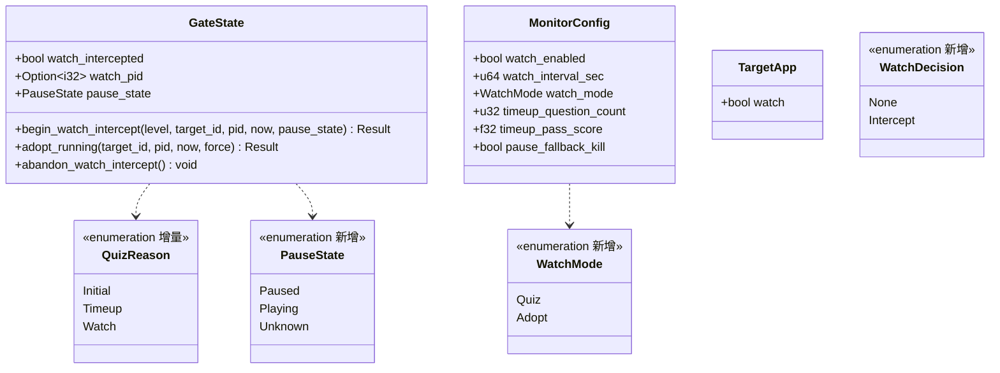
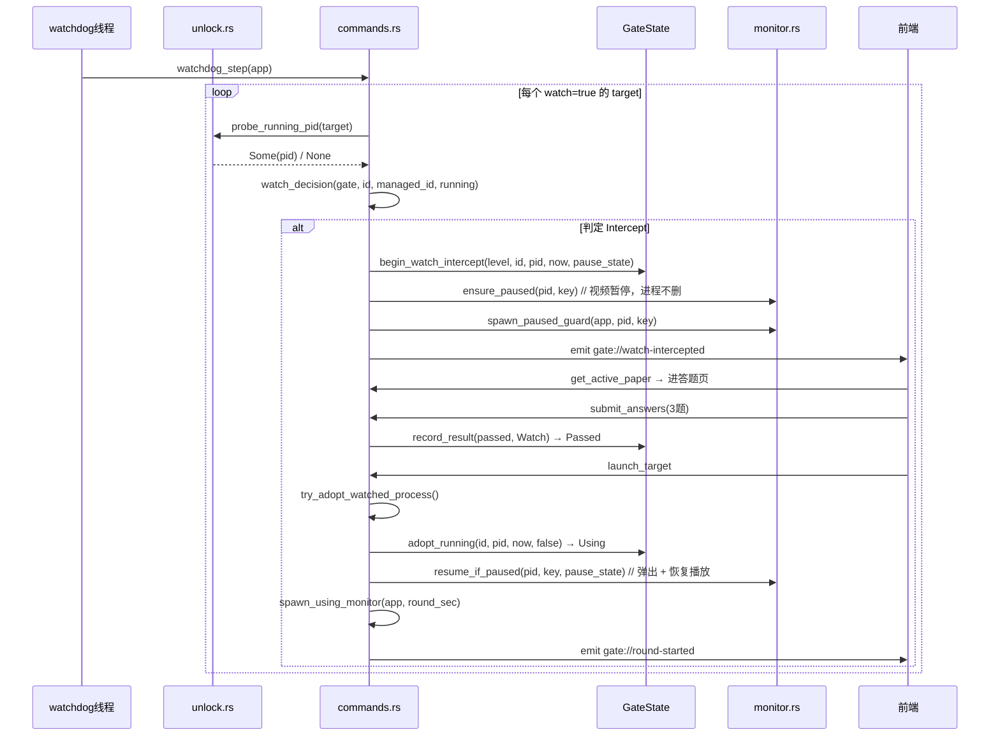

# AnswerGate v3 增量架构设计 — 独立进程监控（watchdog）与「只暂停不删除」

> 版本：v3（增量自 v2）
> 前提：沿用 v2 的架构约定 —— **平台差异只允许出现在 `monitor.rs` 与 `unlock.rs`**；
> 状态权威始终在 Rust 侧，前端只镜像（共享知识 #2 / #3）。

---

## Part A · 增量系统设计

### 1. 方案与选型

| 问题 | v3 方案 | 备选与否决理由 |
|---|---|---|
| 如何发现「绕过本程序启动」的 B 站？ | 周期调用 `unlock::probe_running_pid`（复用已有的 `pgrep_exact` / `tasklist` 能力） | 引入 sysinfo 进程表快照：与 v2「不引入 sysinfo」的决策冲突，且 Electron Helper 子进程多、易误判 |
| 拦截后怎么办？ | 抢前台 + 暂停视频 + 开卷答题（`WatchMode::Quiz`） | 直接接管不打断（`WatchMode::Adopt`）作为可选模式保留，默认选更严格的 Quiz |
| 答对后要不要重新拉起？ | **不拉起**，用 `adopt_running` 接管既有 PID | 重新 `open -a` 会把已运行实例再激活一遍，打断播放进度 |
| 空格是 toggle，怎么防止「暂停守卫把视频又放出来」？ | 引入 `PauseState` 三态 + 播放状态探测（累计 CPU 时间差值） | 无条件重发 toggle：会一停一放，反而削弱管控（本轮实测发现的隐性 bug） |
| 暂停失败怎么办？ | 默认**保留进程**（`pause_fallback_kill = false`），由守卫持续压制 | v2 的自动回退 kill 与「只暂停不能删除」冲突 |

### 2. 文件变更清单

| 文件 | 变更 |
|---|---|
| `src-tauri/src/model.rs` | `TargetApp.watch`；`WatchMode` 枚举；`MonitorConfig` 新增 6 字段；**新增 `PauseState` 枚举**（Paused / Playing / Unknown） |
| `src-tauri/src/config.rs` | `sanitize()`：watch_interval=0→3、timeup_question_count=0→3、timeup_pass_score<1.0→1.0（不可放宽） |
| `src-tauri/src/unlock.rs` | 新增 `probe_running_pid` 公共 API + 4 个平台实现（平台差异允许处） |
| `src-tauri/src/monitor.rs` | 新增 `is_playing` / `cpu_time_sec` / `parse_cpu_time` / `repause_if_playing` / `ensure_paused` / `bring_to_front` / `resume_if_paused` |
| `src-tauri/src/gate.rs` | `QuizReason::Watch`；`GateState` 新增 `watch_intercepted` / `watch_pid` / `pause_state`；新增 `begin_watch_intercept` / `adopt_running` / `abandon_watch_intercept`；`reset_to_idle` 清拦截标记 |
| `src-tauri/src/commands.rs` | `watch_decision` / `spawn_watchdog` / `watchdog_step` / `trigger_watch_intercept` / `try_adopt_watched_process`；`paper_count_for` / `pass_score_for`；`handle_timeout` 改 pause 语义；`paused_guard_step` 扩展覆盖 watch 场景 |
| `src-tauri/src/lib.rs` | setup 增加第 6 步 `commands::spawn_watchdog(handle.clone())` |
| `src/lib/types.ts` | `QuizReason` 增 `"watch"`；`RulesSummary` 增 `timeup_question_count` / `timeup_pass_score` |
| `src/lib/api.ts` | 新增 `onWatchIntercepted` / `onWatchAbandoned` 订阅 |
| `src/lib/gateStore.ts` | 新增 `cameFromWatch` / `quizReason`；`handleWatchIntercepted` / `handleWatchAbandoned`；bootstrap 恢复 quiz 态 |
| `src/App.svelte` | 订阅 v3 新事件 |
| `src/pages/ResultPage.svelte` | 门槛文案随原因切换；watch 通过态文案 |
| `resources/config.toml` | 新增 bilibili target 条目 + v3 全部配置项 |
| `src-tauri/tests/v3_watchdog.rs` | **新增**：17 个 v3 用例 |

### 3. 数据结构与接口（增量）

### 4. 关键不变式

1. **平台差异只在 `monitor.rs` / `unlock.rs`**：`probe_running_pid` 在 `unlock.rs` 分派；`cpu_time_sec` 在 `monitor.rs` 内按 `cfg(target_os)` 分支。
2. **空格是切换语义**：任何发按键的路径都必须先知道「现在是播是停」——
   - 暂停前：`ensure_paused`（ Playing→按 / Paused→不按 / Unknown→按）
   - 守卫中：`repause_if_playing`（ Playing→按 / Paused→不按 / Unknown→**不按**）
   - 恢复时：`resume_if_paused`（ Paused→按 / Playing→**只置前** / Unknown→按）
3. **watchdog 只在 Idle 抢状态**：非 Idle 一律不拦截，避免与答题/纳管/冷却流程打架。
4. **冷却复位必须清拦截标记**：`reset_to_idle` 清 `watch_intercepted` / `watch_pid` / `pause_state`，
   否则 watchdog 会因「已拦截过」永久失效（死锁）。

### 5. 程序调用流程（watchdog 拦截链路）

### 6. 「只暂停不删除」的实现落点

| 场景 | 代码位置 | 行为 |
|---|---|---|
| 超时到点 | `commands::handle_timeout` | `ensure_paused` → 暂停；`pause_fallback_kill=false` 时不 terminate |
| 超时后入题失败 | `commands::handle_timeout`（Err 分支） | pause 模式保留进程（kill 模式才终止） |
| 答题失败进冷却 | `commands::do_submit_answers` | `kill_allowed = timeout_action==Kill \|\| pause_fallback_kill`；pause 模式仅记日志 |
| 监控拦截答题失败 | `commands::do_submit_answers` + 暂停守卫 | 进程存活，视频由守卫维持暂停 |
| 守卫补发暂停 | `commands::spawn_paused_guard` → `monitor::repause_if_playing` | 只在确实在播时补发 |

### 7. 播放状态探测（`monitor::is_playing`）

- 原理：采样两次**进程累计 CPU 时间**（macOS `ps -o time=`；Windows tasklist 的 CPU Time 列），差值 ≥ 阈值即认为在解码播放。
- 采样窗口 1s，阈值 `CPU_BUSY_THRESHOLD_SEC = 0.12`。
- `parse_cpu_time` 支持 `mm:ss.ss` / `hh:mm:ss` / `dd-hh:mm:ss` 三种格式。
- 探测不可用（沙箱受限 / Android）→ 返回 `None`，调用方一律**保守不动作**。
- ⚠️ **真机适配（2026-11-04 macOS）**：本机 `/bin/ps`、`/usr/bin/top` 被系统策略整体禁用
  （`operation not permitted`），只有 `pgrep` 可用。因此 `cpu_time_sec` 改为双路径：
  1. `ps -o time=`（标准路径，可用时最简单）；
  2. **libproc `proc_pidinfo(PROC_PIDTASKINFO)` 兜底** —— 纯用户态系统调用，
     无 root / 无辅助功能权限要求，不受 ps/top 策略影响。
     实测要点：内核实际写入 **96 字节**，缓冲区给 48 会返回 0；CPU 时间在
     u64 数组下标 2/3（偏移 16/24 字节），单位纳秒；「自旋 1.5s → 增量 1.386s」校验精度。
- 同理，`unlock::is_main_app_process` 改为三态 `Option<bool>`：
  `ps` 取不到命令行时降级用 `pgrep -fl` 解析 argv；两者都不可用返回 `None`，
  调用方**采信精确路径 `pgrep` 命中**（该路径已唯一标识主进程，Helper 在 `Contents/Frameworks/`）。
- 阈值 `CPU_BUSY_THRESHOLD_SEC` 由 0.12 上调为 **0.25**：真机实测首页稳定态主进程
  增量 `0.040~0.119s`，原阈值贴着峰值必然误判；上调后留约 2× 余量。

---

## Part B · 任务分解

### 8. 任务列表

| # | 任务 | 状态 |
|---|---|---|
| V3-01 | 配置模型扩展（`watch` / `WatchMode` / `MonitorConfig` 6 字段 / `PauseState`） | ✅ |
| V3-02 | 配置清洗（间隔/题量/及格线不可放宽） | ✅ |
| V3-03 | 跨平台目标进程探测 `probe_running_pid` | ✅ |
| V3-04 | 门禁状态机支持 Watch 拦截与 adopt 纳管 | ✅ |
| V3-05 | watchdog 线程 + 拦截 + 接管既有进程 | ✅ |
| V3-06 | 严格档门槛（3 题全对）+ pause 模式「只暂停不删除」 | ✅ |
| V3-07 | 播放状态探测 + 暂停守卫幂等化 + 恢复播放语义 | ✅ |
| V3-08 | 前端接入（事件订阅 / 横幅 / 门槛文案 / 结果页分支） | ✅ |
| V3-09 | 配置模板补 B 站 target 条目 | ✅ |
| V3-10 | 自动化测试（`tests/v3_watchdog.rs` 19 例 + `e2e_pause_flow` 语义更新 + monitor 2 例） | ✅ |
| V3-11 | 文档同步（README §15 / PRD-v3 / 本文件） | ✅ |
| V3-15 | **真机适配**：`ps`/`top` 被禁用 → libproc CPU 兜底 + `pgrep -fl` 主进程校验 + 阈值校准 0.25 | ✅ |
| V3-16 | **日志落盘**：去掉 `non_blocking` 缓冲，改同步写，进程被杀不丢日志 | ✅ |
| V3-17 | **权限告警**：`gate://permission-required` + 前端常驻告警条 | ✅ |
| V3-12 | macOS 真机回归：拦截/探测/只暂停不删除 **已通过**；暂停→答题→弹出播放待授权辅助功能后闭环 | 🌐 部分 |
| V3-13 | Windows 真机回归（tasklist 探测 + 媒体键 + AppActivate） | 🌐 待做 |
| V3-14 | 播放态 CPU 阈值校准（需授权后 A/B 对比播放 vs 暂停） | 🌐 待做 |

### 9. 共享知识增量

- **空格 = 切换键**：任何「发按键」的实现都必须配套播放状态判定，否则会反向恢复播放。
- **watchdog 判定必须纯逻辑化**：`watch_decision(gate, target_id, managed_target_id, running) -> WatchDecision` 便于单测覆盖组合爆炸。
- **状态复位必须清拦截标记**：冷却到期回 Idle 时若不清，watchdog 会永久失效。
- **`adopt_running` 前先取 `pause_state`**：`enter_using` 会把 `pause_state` 复位为 `Unknown`，顺序反了就丢信息。
- **不要假设 `ps` 可用**：企业策略 / 隐私设置会整体禁用 `ps`/`top`，但 `pgrep` 通常仍可用；
  进程 CPU 时间用 libproc `proc_pidinfo` 兜底最可靠，且**缓冲区必须 ≥96 字节**。
- **日志必须同步落盘**：`non_blocking` appender 默认攒 128 行才刷盘，进程被杀时
  「kill 失败 / pid 探测失败」这些最关键的日志反而全丢。
- **Electron 应用启动受 `ELECTRON_RUN_AS_NODE` 影响**：自动化终端若注入该变量，
  被测试的目标应用会以 Node 模式启动后立即退出（表现为 `open` 返回 0 但进程不存在）。
- **辅助功能权限缺失要显式告知家长**：按键失败不能只写 warn 日志，
  必须 `gate://permission-required` 推前端常驻告警，否则管控静默失效。
