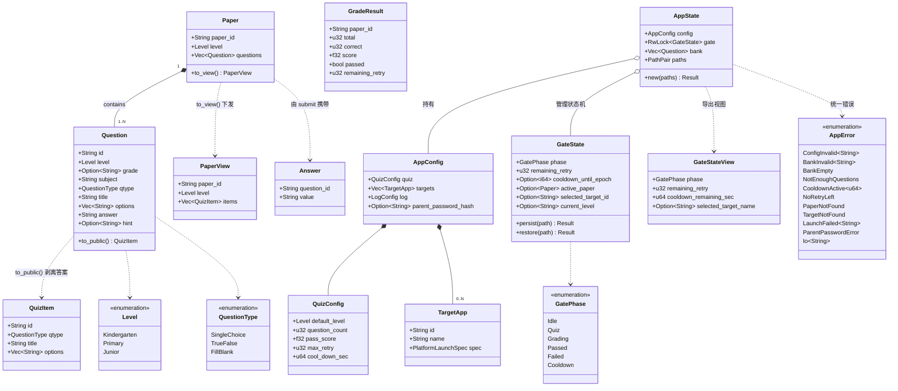
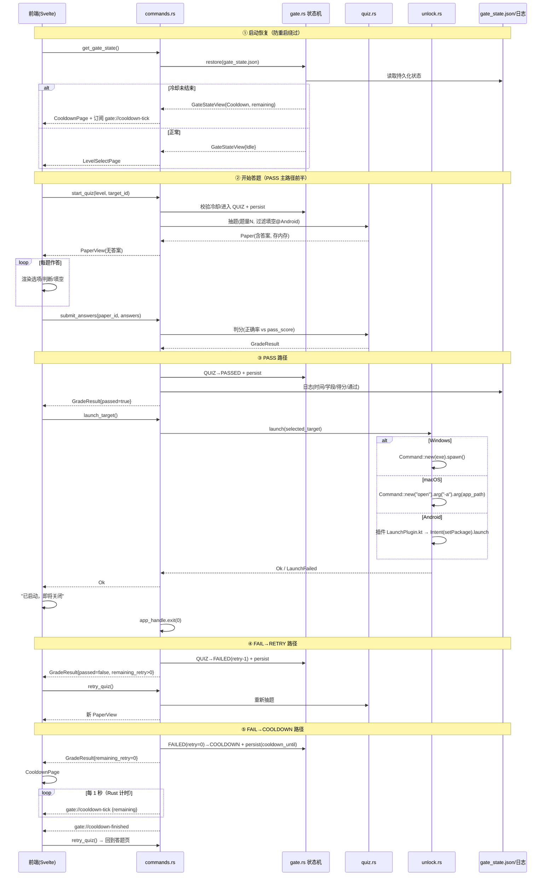
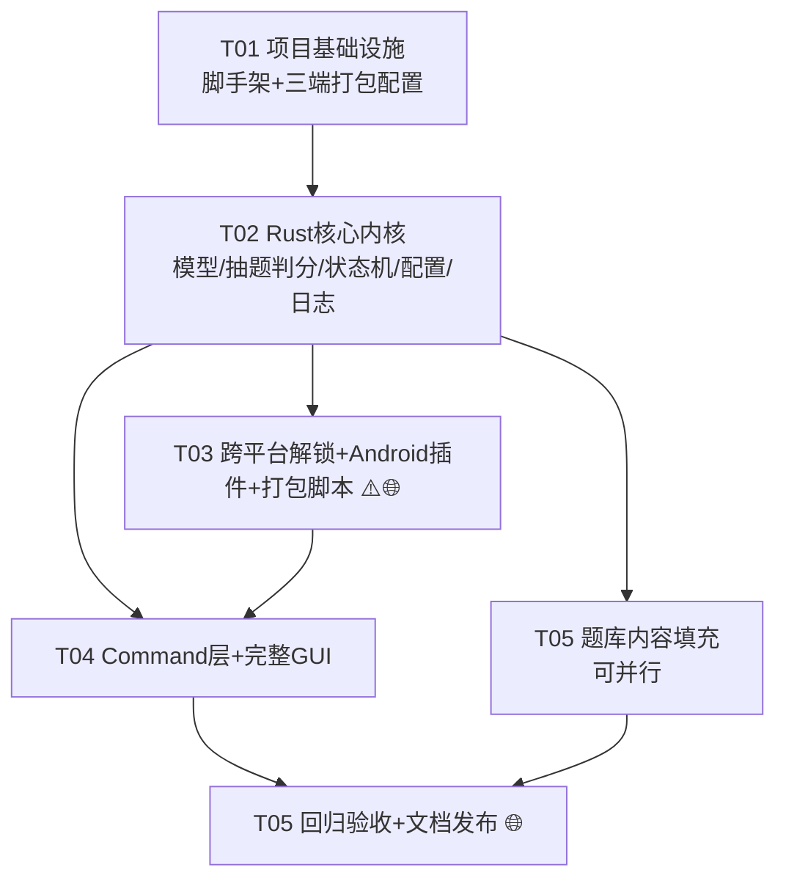

# AnswerGate 答题门禁控制台 — 系统架构设计与任务分解

- **架构师**: 高见远（Bob / Gao）
- **输入**: `README.md`（技术方案）、`docs/PRD.md`（P0-01~P0-11）
- **版本**: v1.0（对应 PRD v1.0，P0 范围 + P1-01 家长密码默认关闭实现）

---

## Part A · 系统设计

### 1. 实现方案与框架选型确认

#### 1.1 核心技术挑战

| # | 挑战 | 应对 |
|---|------|------|
| C1 | 一套代码产出 Windows / macOS / Android 三端 | Tauri 2.0 多 target 打包 + `cfg(target_os)` 条件编译隔离解锁差异 |
| C2 | 防作弊：答案不能出现在前端 | 判分权威在 Rust；`Paper` 下发前剥离 `answer/hint` 字段，仅存 Rust 侧内存 |
| C3 | 重试/冷却防重启绕过 | 状态机状态持久化到 `app_data_dir/gate_state.json`（与 config.toml 分离），启动时恢复；倒计时由 Rust 事件驱动 |
| C4 | 三平台差异化解锁 | Windows `std::process::Command` spawn exe；macOS `open -a`；Android 走 **自研 Tauri 2 Mobile Plugin（Kotlin Intent）** |
| C5 | Android 11+ 包可见性限制 | AndroidManifest 声明 `<queries>` 包名白名单（从 config.toml 的 android 白名单生成/手写） |
| C6 | macOS 沙箱无法启动外部 App | tauri.conf.json 关闭沙箱（macOS entitlements 移除 app-sandbox），打包脚本固化 |
| C7 | 儿童友好 UI 三端复用 | Svelte 5 + 原生 CSS 变量主题，大按钮/大字体组件化；Android 竖屏媒体查询适配 |

#### 1.2 框架选型（确认，与 README 一致）

- **Tauri 2.x**：command/event 桥接 + 三端打包；Android 端通过 Tauri 2 官方 mobile plugin 机制（`tauri plugin new --android` 生成的 Kotlin/Rust 混合插件）实现 Intent 跳转，这是 Tauri 2 官方支持的路径，无需裸 JNI。
- **Svelte 5 + TypeScript + Vite**：轻量、runes 响应式足够支撑 4 个页面的线性流程，无路由库（用前端 phase 状态切换页面，与 Rust GatePhase 对齐）。
- **Rust 侧**：serde/serde_json/toml 数据层，rand 抽题，tracing 落日志，thiserror 统一错误。
- **架构模式**：前端薄展示层（View only）+ Rust 单体内核（模块分层：model / quiz / config / gate / unlock / log / commands）。

#### 1.3 前后端职责边界（核心约定）

| 职责 | 归属 | 说明 |
|------|------|------|
| 页面渲染、交互动效 | 前端 | 仅展示，不持有任何权威状态 |
| 抽题、判分、及格线判定 | Rust | 答案永不下发前端 |
| 重试/冷却状态机 + 持久化 | Rust | 前端页面刷新不重置状态 |
| 解锁启动目标软件 | Rust（分平台） | 成功后 Rust 主动 `app.exit()` |
| 配置/题库读取与校验 | Rust | 缺省回退默认值 |
| 日志 | Rust | tracing → 本地文件 |

### 2. 文件列表（完整骨架）

```
AnswerGate/
├── package.json                          # npm 依赖与脚本（dev/build/tauri）
├── vite.config.ts                        # Vite 构建 + Tauri 前端集成配置
├── svelte.config.js                      # Svelte 5 编译配置（vitePreprocess）
├── tsconfig.json                         # TS 严格模式配置
├── index.html                            # SPA 入口 HTML
├── src/
│   ├── main.ts                           # 前端入口，挂载 App
│   ├── App.svelte                        # 根组件：按 gatePhase 切换四个页面
│   ├── app.css                           # 全局主题：CSS 变量、大字体、大按钮、竖屏适配
│   ├── lib/
│   │   ├── api.ts                        # Tauri invoke/listen 的类型化封装（唯一前端↔后端通道）
│   │   ├── types.ts                      # 与 Rust 结构体对齐的 TS 类型定义
│   │   └── gateStore.svelte.ts           # Svelte 5 runes 全局状态（镜像 Rust GateStateView）
│   ├── components/
│   │   ├── BigButton.svelte              # 通用大按钮（≥64px，触屏/键盘均可）
│   │   ├── ProgressHeader.svelte         # 答题页顶部"第 x/N 题"+进度条
│   │   ├── CountdownRing.svelte          # 冷却页圆形倒计时（Rust 事件驱动）
│   │   └── ShakeFeedback.svelte          # 答错抖动/提示动效容器
│   └── pages/
│       ├── LevelSelectPage.svelte        # 学段选择页（三张大卡片 + 规则摘要）
│       ├── TargetSelectPage.svelte       # 目标软件选择页（多白名单时展示，单目标自动跳过）
│       ├── QuizPage.svelte               # 答题页（单选/判断/填空三种作答区）
│       ├── ResultPage.svelte             # 结果页（通过→启动倒计时 / 失败→剩余重试）
│       └── CooldownPage.svelte           # 冷却页（倒计时，重启恢复）
├── src-tauri/
│   ├── Cargo.toml                        # Rust 依赖声明
│   ├── build.rs                          # tauri-build
│   ├── tauri.conf.json                   # 打包配置：窗口 800×600、resources、bundle、macOS 沙箱关闭
│   ├── capabilities/default.json         # Tauri 2 权限声明（核心 command 可用性）
│   ├── src/
│   │   ├── main.rs                       # 桌面端入口（调 lib::run）
│   │   ├── lib.rs                        # 应用装配：manage(AppState)、注册 commands、初始化日志
│   │   ├── error.rs                      # AppError 统一错误（thiserror + 序列化为 {code,message}）
│   │   ├── model.rs                      # Question/Level/QuestionType/Answer/GradeResult/GateState 等结构体
│   │   ├── config.rs                     # 读取 config.toml（app_data 优先，缺省回退默认值）
│   │   ├── quiz.rs                       # 题库加载、过滤、随机抽题（去重/移动端过滤填空）、判分
│   │   ├── gate.rs                       # 门禁状态机 IDLE→QUIZ→GRADING→PASS/FAIL/COOLDOWN + 持久化 gate_state.json
│   │   ├── unlock.rs                     # 跨平台解锁：cfg(target_os) 三分支 + 调 Android 插件
│   │   ├── log.rs                        # tracing 初始化，落地 answer_gate.log
│   │   └── commands.rs                   # Tauri command 层（下表全部签名）
│   ├── plugins/answergate-launch/        # 自研 Tauri 2 Mobile Plugin（Android Intent 启动）
│   │   ├── Cargo.toml                    # 插件 Rust 侧（desktop 空实现 / mobile 绑定）
│   │   ├── build.rs
│   │   ├── android/build.gradle.kts      # 插件 Android 模块
│   │   └── android/src/main/java/com/answergate/launch/LaunchPlugin.kt  # Kotlin: Intent+setPackage 启动
│   ├── gen/android/                      # tauri android init 生成（含 AndroidManifest queries 修改）
│   └── tests/
│       ├── unit_core.rs                  # quiz/gate/config 核心单元测试（cargo test 集成入口之一）
│       └── check_bank.rs                 # 题库 JSON schema 校验（id 唯一、答案在选项内、字段完整）
├── resources/
│   ├── question_bank/
│   │   ├── kindergarten.json             # 幼儿园题库 ≥50 题
│   │   ├── primary.json                  # 小学题库 ≥100 题
│   │   └── junior.json                   # 初中题库 ≥100 题
│   └── config.toml                       # 默认配置模板（首启复制到 app_data_dir）
├── scripts/
│   ├── build_all.sh                      # macOS/Linux 打包脚本（dmg + lipo 通用包）
│   ├── build_windows.ps1                 # Windows 打包脚本（exe/msi）
│   └── build_android.sh                  # Android APK 打包脚本
├── tests/README.md                       # 手动回归清单（三端验收 checklist）
└── docs/                                 # PRD / ARCHITECTURE / mermaid 图
```

### 3. 数据结构与接口

#### 3.1 Rust 结构体（classDiagram）



#### 3.2 Tauri Command 签名清单

```rust
// commands.rs —— 前端可调用的全部能力（错误统一 AppError，序列化为 {code, message}）

/// 获取规则摘要（题量/及格线/冷却时长）+ 学段列表，供学段选择页底部文案
#[tauri::command] fn get_app_config(state) -> Result<RulesSummary, AppError>;

/// 白名单目标软件列表（多目标时学段选择前展示；单目标前端自动跳过选择）
#[tauri::command] fn list_targets(state) -> Result<Vec<TargetAppView>, AppError>;

/// 开始答题：校验冷却 → 抽题（移动端过滤 FillBlank）→ 状态机 IDLE→QUIZ → 持久化
/// 返回剥离答案的试卷视图
#[tauri::command] fn start_quiz(state, level: Level, target_id: Option<String>) -> Result<PaperView, AppError>;
//   错误: CooldownActive{剩余秒} / NotEnoughQuestions / TargetNotFound / BankInvalid

/// 失败后"再试一次"：校验 remaining_retry > 0 → 重新抽题，QUIZ 保持
#[tauri::command] fn retry_quiz(state) -> Result<PaperView, AppError>;
//   错误: NoRetryLeft / CooldownActive

/// 提交作答 → Rust 判分 → 状态机 QUIZ→GRADING→PASS/FAILED → 持久化 → 记日志
#[tauri::command] fn submit_answers(state, paper_id: String, answers: Vec<Answer>) -> Result<GradeResult, AppError>;
//   错误: PaperNotFound
//   FAIL 且 remaining_retry==0 时状态机自动进入 COOLDOWN（前端据 GradeResult 跳页）

/// 解锁启动目标软件（PASS 后调用；按 spec 分平台执行）
/// 成功后 Rust 记日志并延迟 1s 调用 app_handle.exit(0)
#[tauri::command] fn launch_target(state, app_handle) -> Result<(), AppError>;
//   错误: LaunchFailed{原因：路径不存在/Intent失败/包未安装}

/// 启动恢复：读取持久化 GateState；若在冷却中返回剩余秒数，前端直接进冷却页
#[tauri::command] fn get_gate_state(state) -> Result<GateStateView, AppError>;

/// 家长密码应急解锁（P1-01，config 默认关闭；密码 hash 存 config，错误记日志）
#[tauri::command] fn parent_unlock(state, app_handle, password: String) -> Result<(), AppError>;
```

**事件（Rust → 前端，单向推送）**：

```rust
"gate://cooldown-tick"     // payload: { "remaining": u64 }  冷却期间每秒推送（Rust 计时权威）
"gate://cooldown-finished" // payload: {}                    倒计时归零，前端自动跳答题页
```

### 4. 程序调用流程（时序图）



### 5. 待明确事项与默认决策

| # | 事项 | 建议默认值（按此推进） |
|---|------|------------------------|
| U1 | 冷却状态文件被孩子删除怎么办？ | 应用层无法 100% 防删；`gate_state.json` 采用非常规文件名 + 删除时记日志告警；文档说明配合系统家长控制。不引入强加密（P1-02 后续做） |
| U2 | Android 端 `queries` 白名单来源 | 构建脚本从 `config.toml` 的 `target_apps.android` 包名列表生成 `AndroidManifest.xml` 的 `<queries>` 节点；config 运行时新增的包若未声明，跳转会静默失败——文档明确"改包名需重新打包"，规避 Android 11 系统限制 |
| U3 | 判分"填空题字符串匹配"细则 | 去除首尾空格 + 全角转半角 + 忽略大小写后精确匹配；多答案用 `\|` 分隔（answer 字段） |
| U4 | 答题页能否回退改答案 | 允许"上一题"修改，`submit_answers` 提交整卷一次性判分（符合 PRD 5.3） |
| U5 | cooldown-tick 由谁计时 | Rust 侧 `spawn` 异步任务每秒 emit，前端只渲染；重启后 `get_gate_state` 恢复剩余秒数 |
| U6 | 家长密码存储 | config 中存 SHA-256 hash（sha2 crate），不做盐（本地低敏场景，P1-02 再加固） |

---

## Part B · 任务分解

### 6. 依赖包

**Rust（src-tauri/Cargo.toml）**：

```
tauri = { version = "2", features = [] }
tauri-plugin-opener = "2"            # 可选备用打开方式（文档用，主逻辑自研）
serde = { version = "1", features = ["derive"] }
serde_json = "1"
toml = "0.8"
rand = "0.8"
tracing = "0.1"
tracing-subscriber = { version = "0.3", features = ["env-filter", "fmt", "time"] }
tracing-appender = "0.2"             # 日志滚动落地文件
chrono = { version = "0.4", features = ["serde"] }
thiserror = "1"
sha2 = "0.10"                        # 家长密码 hash（P1-01）
answergate-launch = { path = "plugins/answergate-launch" }   # 自研移动端插件
[target.'cfg(not(target_os = "android"))'.dependencies]
tauri = { version = "2", features = ["tray-icon"] }  # 桌面特性按需
[build-dependencies]
tauri-build = { version = "2", features = [] }
[dev-dependencies]
tempfile = "3"
```

**npm（package.json）**：

```
@tauri-apps/api@^2
@tauri-apps/cli@^2 (dev)
svelte@^5
@sveltejs/vite-plugin-svelte@^4 (dev)
typescript@^5.5 (dev)
vite@^5 (dev)
svelte-check@^4 (dev)
```

### 7. 任务列表（按依赖排序，CRITICAL）

> **验证标注**：✅本机 = macOS 开发机可直接验证；🌐跨平台 = 需 Windows 真机 / Android 真机或模拟器，本机只能保证编译通过与配置正确。

---

#### T01 项目基础设施（脚手架 + 三端打包配置骨架）✅本机

- **涉及文件**：`package.json`、`vite.config.ts`、`svelte.config.js`、`tsconfig.json`、`index.html`、`src/main.ts`、`src/App.svelte`（空壳）、`src/app.css`（主题变量）、`src-tauri/Cargo.toml`、`src-tauri/build.rs`、`src-tauri/tauri.conf.json`、`src-tauri/capabilities/default.json`、`src-tauri/src/main.rs`、`src-tauri/src/lib.rs`（最小可运行装配）、`resources/config.toml`（模板）、`.gitignore`
- **依赖**：无
- **优先级**：P0
- **完成标准**：`npm install && npm run tauri dev` 在 macOS 打开 800×600 空白窗口无报错；`tauri.conf.json` 含 resources 声明、窗口固定尺寸、**macOS 关闭沙箱**（entitlements 移除 app-sandbox，风险点提前踩）；`npm run build` 前端产物通过 svelte-check。

#### T02 Rust 核心内核（数据模型 + 抽题判分 + 状态机 + 配置 + 日志）✅本机

- **涉及文件**：`src-tauri/src/model.rs`、`src-tauri/src/error.rs`、`src-tauri/src/quiz.rs`、`src-tauri/src/config.rs`、`src-tauri/src/gate.rs`、`src-tauri/src/log.rs`、`src-tauri/tests/unit_core.rs`、`src-tauri/tests/check_bank.rs`
- **依赖**：T01
- **优先级**：P0
- **完成标准**：`cargo test` 全绿，覆盖：①非法 JSON/缺字段配置友好报错与默认值回退；②抽题去重、题量不足回退、Android 过滤填空；③判分全对/全错/80%边界；④状态机全路径 PASS / FAIL→RETRY / RETRY 耗尽→COOLDOWN，且 `gate_state.json` 持久化与恢复正确（重启不重置，删 config.toml 不影响）；⑤题库校验脚本可检出重复 id / 答案不在选项内 / 字段缺失。

#### T03 跨平台解锁模块 + Android 移动插件 + 打包脚本（🌐跨平台为主，macOS 分支✅本机）

- **涉及文件**：`src-tauri/src/unlock.rs`、`src-tauri/plugins/answergate-launch/`（Cargo.toml、build.rs、android/build.gradle.kts、`LaunchPlugin.kt`）、`src-tauri/gen/android`（AndroidManifest `<queries>` 声明）、`scripts/build_all.sh`、`scripts/build_windows.ps1`、`scripts/build_android.sh`
- **依赖**：T02（依赖 model/config 的 TargetApp 结构）
- **优先级**：P0 ⚠️风险最高，紧随内核
- **完成标准**：
  - ✅本机：macOS 分支 `open -a` 可拉起 /Applications 下真实 App；Windows 分支 `cargo check --target x86_64-pc-windows-msvc` 编译通过；`cargo check` Android target 通过（需安装 NDK，若环境缺失则标记为待验证项并保证代码审查通过）。
  - 🌐需真机验证：Windows 真机 spawn exe（含路径不存在错误提示）；Android 真机（11+）经插件 Intent 跳转白名单包名 App、未安装包时报 LaunchFailed；三端打包脚本各产出安装包（macOS .dmg 可本机产出并验证）。

#### T04 Tauri Command 层 + 完整 GUI（四页面 + 状态机串通 + 移动端适配）✅本机（Android 适配需🌐真机/模拟器）

- **涉及文件**：`src-tauri/src/commands.rs`、`src-tauri/src/lib.rs`（注册 commands/事件）、`src/lib/api.ts`、`src/lib/types.ts`、`src/lib/gateStore.svelte.ts`、`src/components/BigButton.svelte`、`src/components/ProgressHeader.svelte`、`src/components/CountdownRing.svelte`、`src/components/ShakeFeedback.svelte`、`src/pages/LevelSelectPage.svelte`、`src/pages/TargetSelectPage.svelte`、`src/pages/QuizPage.svelte`、`src/pages/ResultPage.svelte`、`src/pages/CooldownPage.svelte`、`src/App.svelte`
- **依赖**：T02（commands）、T03（launch_target 依赖 unlock）
- **优先级**：P0
- **完成标准**：
  - ✅本机：macOS 端完整走通"学段选择→(多目标选择)→答题→判分→启动外部 App→自动退出"全流程；FAIL→再试一次、重试耗尽→冷却倒计时（Rust 事件驱动）→归零回答题页；杀进程重启后冷却状态恢复进冷却页；答错抖动动效、大按钮（≥64px）大字体达标。
  - 🌐需真机验证：Android 竖屏布局无遮挡、填空题已被抽题过滤、返回键答题页拦截确认。

#### T05 题库内容填充 + 回归验收 + 文档发布 ✅本机（内容校验）/ 🌐（三端真机回归）

- **涉及文件**：`resources/question_bank/kindergarten.json`（≥50 题）、`resources/question_bank/primary.json`（≥100 题）、`resources/question_bank/junior.json`（≥100 题）、`tests/README.md`（三端手动回归清单）、`README.md`（家长配置指南：改白名单/调及格线/替换题库/Android 改包名需重打包说明）
- **依赖**：T02（题库校验脚本）；可与 T03/T04 并行推进内容编写，最终合入依赖 T04
- **优先级**：P0（题库）/ P1（文档）
- **完成标准**：三份题库通过 `check_bank.rs` 校验（schema 合法、id 唯一、答案合法）；cargo test + svelte-check 全绿；三端真机按回归清单逐项走通"答题→解锁→退出"（🌐）；非技术家长按 README 可独立完成白名单与及格线修改（✅可由文档走查验证）。

---

### 8. 共享知识（跨文件约定）

1. **错误约定**：所有 command 返回 `Result<T, AppError>`；`AppError` serde 序列化为 `{"code": "CooldownActive", "message": "冷却中，剩余 87 秒", "data": {"remaining": 87}}`；前端 `api.ts` 统一解析 code 分支处理，禁止裸字符串匹配。
2. **答案保密**：`Question.answer/hint` 永不进入任何下发前端的类型；`PaperView/QuizItem` 为前端唯一题目来源。
3. **状态权威**：重试/冷却只在 `GateState`（gate.rs）维护并持久化到 `app_data_dir/gate_state.json`（`{"phase":"cooldown","remaining_retry":0,"cooldown_until_epoch":1719999999}`）；前端 store 仅镜像 `GateStateView`，页面刷新即从 `get_gate_state` 重建。
4. **文件位置**：config 运行时读取 `app_data_dir/config.toml`（首启从 resources 复制默认模板，家长可编辑）；题库只读加载 `resources/question_bank/*.json`；日志 `app_data_dir/logs/answer_gate.log`（tracing-appender 按天滚动）。
5. **事件命名**：Rust→前端事件统一前缀 `gate://`（`cooldown-tick`、`cooldown-finished`）；command 命名 snake_case，与 Rust 函数名一致。
6. **日志格式**：结构化字段 `target=answergate`，事件行含 `event=quiz_start|quiz_submit|grade|unlock|parent_unlock_fail`、`level=...`、`score=...`、`result=pass|fail|launch_ok|launch_err`，家长可直接打开阅读。
7. **平台隔离**：所有平台差异代码只允许出现在 `unlock.rs`（`cfg(target_os)` 三分支）与 `plugins/answergate-launch`（Android Kotlin）内；UI 层通过 `api.ts` 内的 `platform` 判断仅做展示差异（如隐藏填空输入）。
8. **日期时间**：内部一律存 Unix epoch 秒（`i64`），展示层格式化；`cooldown_until_epoch` 为持久化字段。
9. **UI 规范**：按钮高 ≥64px、正文 ≥20px、触屏点击区 ≥48px；窗口固定 800×600 桌面居中；Android 竖屏，主轴纵向排列。

### 9. 任务依赖图



> 工期预估：T01 0.5 天 → T02 1 天 → T03 1.5 天（与 T05 内容填充并行）→ T04 2 天 → T05 收尾 1 天，合计约 6~7 个工作日（本机可完成 T01/T02/T04 主体与 macOS 全流程验证；Windows/Android 真机回归为最后里程碑）。
